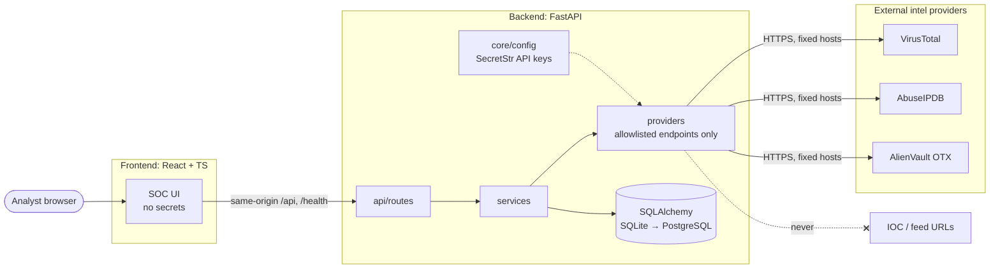

# ThreatScope

ThreatScope is a lightweight **Threat Intelligence Platform** for **passive** IOC enrichment. An analyst submits indicators such as IP addresses, domains, URLs, and file hashes. ThreatScope then queries reputable intelligence providers, combines their verdicts, and helps track investigations over time. It never visits, downloads, or executes anything an indicator points to.

It is a portfolio project that demonstrates security engineering, threat intelligence, API integration, Python/FastAPI, React/TypeScript, Docker, testing, and secure-by-design development.

## Status

**Phase 5: persistent analyst workflow.** Investigations are saved and searchable, and a watchlist, notes, tags, and IOC relationships have been added. These sit alongside the threat feed and IOC enrichment from VirusTotal, AbuseIPDB, and AlienVault OTX with explainable risk scoring.

- ✅ FastAPI backend with a layered architecture and a `GET /health` endpoint
- ✅ React + TypeScript + Tailwind navigation shell with a dark SOC theme
- ✅ Docker Compose dev stack (non-root, hardened, localhost-only)
- ✅ GitHub Actions CI: ruff and pytest for the backend; lint and build for the frontend
- ✅ IOC engine: IPv4, IPv6, domain, URL, MD5, SHA1, SHA256, with automatic type detection, normalization, refanging, and network-scope labeling
- ✅ `POST /api/investigate` and `POST /api/investigate/bulk` (validation only), with a consistent error format
- ✅ Investigate and Bulk Analysis pages
- ✅ Provider adapters (VirusTotal, AbuseIPDB, OTX) with timeouts, rate-limit cooldown, failure isolation, and a deterministic, clearly labeled demo mode
- ✅ Explainable 0–100 risk score with contributing factors ([algorithm](docs/risk-scoring.md))
- ✅ Providers page (`GET /api/providers/status`) showing configured, not configured, or unavailable, with keys never revealed
- ✅ Threat feed from CISA KEV, Microsoft Threat Intelligence, Cisco Talos, SentinelOne Labs, and The DFIR Report, with filters, KEV designation, literal entity and IOC extraction, trending in collected data, and an analyst workflow ([details](docs/threat-feed.md)). CISA Advisories is planned.
- ✅ Investigation history: search, type and risk filters, date sorting, and reopening a saved investigation
- ✅ Watchlist (Monitoring, Investigating, Confirmed Malicious, False Positive, Closed) with tags and notes
- ✅ IOC relationships (domain → IP, IP → ASN, hash → malware, IOC → actor, campaign, tags), taken only from live provider data or analyst entry ([data model](docs/data-model.md))
- ✅ Alembic migrations, PostgreSQL-ready schema
- ⏳ Bulk enrichment and dashboard have not started yet

## Planned features

- Single-IOC investigation (IP, domain, URL, hash) with normalized multi-provider verdicts
- Provider adapters: VirusTotal, AbuseIPDB, AlienVault OTX
- Bulk analysis of indicator lists
- Curated threat feed from trusted, allowlisted sources
- Saved investigations and a watchlist
- Provider status page and a demo mode that needs no API keys
- PostgreSQL support

## Architecture



See [`docs/architecture.md`](docs/architecture.md) for the layer rules and the PostgreSQL migration path.

```
backend/    FastAPI app (app/api, services, providers, models, schemas, db, core) + tests
frontend/   React + TypeScript + Tailwind (Vite)
docs/       Architecture and security model
.github/    CI workflows
```

## Development setup

**Prerequisites:** Docker with Docker Compose. Node and Python are optional and only needed to run tools outside containers.

```bash
cp .env.example .env          # optional; demo mode needs no keys
docker compose up --build
```

- UI: http://localhost:5173
- API health: http://localhost:8000/health
- API docs: http://localhost:8000/docs

Run the backend tests in a container:

```bash
docker compose run --rm backend pytest
```

Or run checks locally (Python 3.14, Node 24):

```bash
cd backend && pip install -r requirements-dev.txt && ruff check . && pytest
cd frontend && npm ci && npm run lint && npm run build
```

## Security philosophy

ThreatScope treats **every indicator and every feed entry as hostile input**.

- **Passive only.** IOC URLs are data, not destinations. Nothing submitted is visited, downloaded, rendered as HTML, or executed.
- **No SSRF surface.** The backend only contacts explicitly configured provider endpoints. User or feed content never decides where it connects.
- **Secrets stay server-side.** API keys exist only as backend environment variables (`SecretStr`). The frontend never sees them, and `.env` is never committed.
- **Least privilege.** Containers run as non-root with all capabilities dropped, ports bind to localhost, and CI has read-only permissions.
- **Minimal, pinned dependencies.**

The full policy is in [`CLAUDE.md`](CLAUDE.md), and the threat model is in [`docs/security.md`](docs/security.md).

## License

[MIT](LICENSE)
