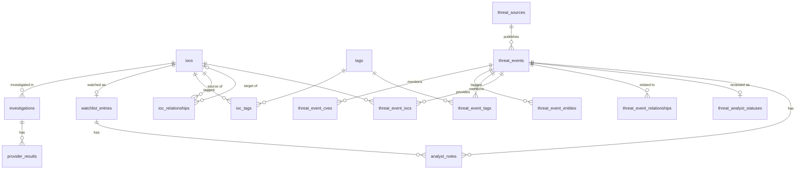

# Data Model

The SQLAlchemy models live in `backend/app/models/`. The schema is managed by Alembic migrations in `backend/migrations/`, which run automatically at startup. Column types are portable (`String`, `Text`, `Integer`, `BigInteger`, `Boolean`, `DateTime(timezone=True)`, `JSON`), constraint names are explicit, and foreign keys are enforced on SQLite too (`PRAGMA foreign_keys=ON`). Moving to PostgreSQL is therefore a `DATABASE_URL` and driver change.

## Shared tables (avoiding duplication)

| Table | Shared by |
|-------|-----------|
| `iocs`: one row per normalized `(type, value)` | investigations, the watchlist, IOC relationships, and IOCs extracted from threat events. Network scope is recomputed from the value rather than stored. |
| `tags`: normalized lowercase names | IOC tags (`ioc_tags`) and threat-event tags (`threat_event_tags`) |
| `analyst_notes` | watchlist entries and threat events. A CHECK constraint enforces exactly one target. "ThreatAnalystNote" is this table with `threat_event_id` set. |
| `threat_sources` | source metadata (synced from code at startup) plus fetch state such as ETag and cooldown. This replaces the former `feed_source_state`. |

## Requested model → table

| Model | Table |
|-------|-------|
| IOC | `iocs` |
| Investigation | `investigations` (risk score, level, summary, and factors are stored as they were computed) |
| ProviderResult | `provider_results` (normalized fields only, never raw responses) |
| WatchlistEntry | `watchlist_entries` (one per IOC; status: monitoring, investigating, confirmed_malicious, false_positive, closed) |
| AnalystNote / ThreatAnalystNote | `analyst_notes` |
| Tag | `tags` + `ioc_tags` (`origin` = `analyst` or a provider name) |
| IOCRelationship | `ioc_relationships` |
| ThreatEvent | `threat_events` (KEV details as published, in `kev` JSON) |
| ThreatSource | `threat_sources` |
| ThreatEventIOC | `threat_event_iocs` → `iocs` |
| ThreatEventCVE | `threat_event_cves` |
| ThreatEventTag | `threat_event_tags` → `tags` |
| ThreatEventRelationship | `threat_event_relationships` (stored once per pair, `event_id < related_event_id`) |
| ThreatAnalystStatus | `threat_analyst_statuses`, kept apart from `threat_events` so re-collection never touches analyst state |
| *(other entities)* | `threat_event_entities` (`kind` = threat_actor, malware, campaign, technique, product, industry, or country) |

## IOC relationships: never invented

| Relationship | Stored when |
|--------------|-------------|
| Domain → IP (`resolves_to`) | **Analyst only.** No provider data used by ThreatScope supplies resolutions, and nothing is resolved. |
| IP → ASN (`asn`) | A live provider result reports an ASN for an IP, or an analyst enters it |
| Hash → Malware (`malware`) | A live provider result names malware families for a file hash, or an analyst enters it |
| IOC → Threat actor (`threat_actor`) | A live provider result names actors (e.g. OTX pulse adversaries), or an analyst enters it |
| IOC → Campaign (`campaign`) | **Analyst only** (no current provider supplies campaigns) |
| IOC → Tags (`ioc_tags`) | Live provider tags (`origin` = provider), or analyst tags |

Rules:
- **Simulated (DEMO_MODE) results and failed lookups never create relationships or tags.**
- Each relationship records its `origin`, its `evidence`, and the investigation that produced it. Repeated observations update `last_observed_at` instead of creating duplicates.
- Analyst entries are validated by IOC type. For example, only a domain can resolve to an IP, and only a hash maps to malware.
- Analysts can delete only analyst-entered relationships and tags. Provider-derived ones are evidence and stay.
- Threat-feed IOCs are linked to their report (`threat_event_iocs`) but are **not** linked to the report's actors or malware, because that link would be inferred.

## Migrations

| Revision | Purpose |
|----------|---------|
| `0001` | Baseline: the Phase 4 schema. Databases created by `create_all` before migrations existed are stamped at this revision. |
| `0002` | This schema. Migrates existing events, source state, analyst statuses, and notes into the normalized tables, and builds related-event pairs in SQL. Not reversible: restore a backup instead. |

`tests/test_migrations.py` checks that migrations and models have no drift, that a legacy database upgrades with its data preserved, and that foreign keys, CHECK constraints, and cascades are enforced.
